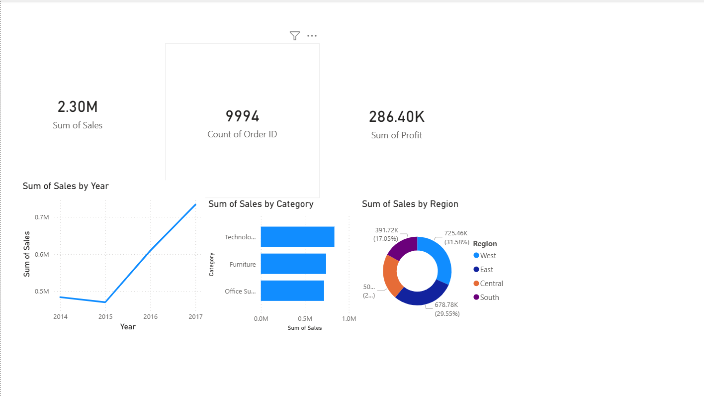

# 📊 Superstore Sales Dashboard — Power BI

An interactive business dashboard built in Power BI Desktop,
visualizing key sales metrics from the Superstore retail dataset (2014–2017).

---

## 📸 Dashboard Preview

---

## 📈 Visuals Included

| Visual | Type | Insight |
|--------|------|---------|
| Total Revenue | KPI Card | $2.30M total sales |
| Total Orders | KPI Card | 9,994 orders |
| Total Profit | KPI Card | $286.40K profit |
| Sales by Year | Line Chart | +51% growth 2014→2017 |
| Sales by Category | Bar Chart | Technology leads at $836K |
| Sales by Region | Donut Chart | West dominates at 31.58% |

---

## 🛠️ Tools Used

- **Power BI Desktop** — dashboard creation
- **Dataset:** Kaggle Superstore (9,994 records, 2014–2017)

---

## 💡 Key Insights

1. Sales grew consistently from $0.5M (2014) to $0.7M (2017)
2. Technology is the top category ($836K revenue)
3. West region leads with 31.58% of total sales
4. South region has the lowest share at 17.05%

---

## 🎯 What I would do about it

**1. Add a margin measure before anyone acts on this dashboard**
Every visual here reports revenue. Technology leading at $836K says where the
money comes in, not where it stays: with $286.40K profit on $2.30M of sales, the
business keeps about 12 cents on the dollar, and that rate is not evenly spread.
A revenue-only dashboard quietly invites the wrong decision, so profit and margin
belong beside each card.

**2. Do not read the South gap as untapped potential yet**
West at 31.58% against South at 17.05% is a real gap, but share alone cannot say
why. A smaller market, fewer reps, and weaker demand all produce the same bar.
The next cut is revenue per customer and per rep by region — if the South matches
on those, the gap is coverage and worth investing in; if it does not, the region
is simply smaller and the budget is better spent elsewhere.

**3. Use +51% over four years as the baseline, not the headline**
Growth from $0.5M to $0.7M is roughly 11% a year. That is the number future
quarters should be measured against, and it is worth knowing whether it came from
more orders or larger ones — the two call for different work.

**4. Make the dashboard answer a question, not just display totals**
The next version I would build adds a discount filter, since discounting above 30%
turns orders unprofitable in this dataset. That turns the page from a report into
something a manager can act on.

---

*Part of a Data Analytics portfolio for OJT applications.*